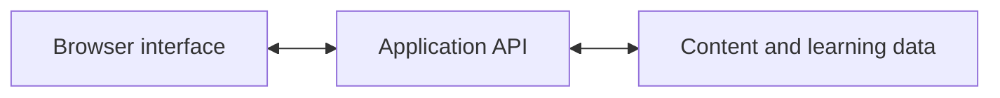

# LingualGain

A language-learning app built around short conversations, with listening, contextual help and opportunities to respond.

**In development.** Built by [Vincent Unruh](https://github.com/vincentunruh). This repository is a product and engineering showcase, not a runnable application or public demo.

## Learning Through Conversation

The aim is to keep useful language connected to a situation, rather than present it as an isolated list to memorise.

- Follow dialogue one sentence at a time, with scene imagery and audio controls.
- Reveal translations and open contextual word explanations without leaving the conversation.
- Respond through choice-based and typed practice, with feedback.
- Use recording and pronunciation-practice interfaces where the speech service is available.
- Return to saved learning positions and revisit material through Review.

These interactions are implemented. Content availability and speech-provider validation remain separate from the interface, and learning effectiveness has not been established by learner studies.

## The Engineering Behind It

### Keep The Conversation Stable

Dialogue, translations, audio and navigation all share one small screen. Changing one should not unexpectedly move another or leave the wrong sentence playing. I separate rendering from interaction lifecycle ownership and test navigation alongside the controls it affects. The trade-off is more explicit coordination, rather than treating each control as an independent widget.

### Make Help Available Without Losing Context

A word explanation should be easy to open and just as easy to leave. Contextual sheets keep the conversation in place, with keyboard dismissal and focus restoration. That lets help remain a secondary interaction instead of turning every unfamiliar word into a new page.

### Separate Content Preparation From Delivery

Learning material has dependencies: dialogue, translations, examples and exercises need to agree. The backend models content versions and validation/review states separately from learner delivery. This makes missing preparation visible rather than treating every generated result as ready to teach.

[Engineering notes: decisions, trade-offs and verification](docs/engineering.md)

## Technology

| Technology | Role |
| --- | --- |
| JavaScript, HTML and CSS | Browser interface and interaction behaviour |
| Node.js and Express | Application backend and HTTP API |
| MongoDB | Application and learning-content persistence |
| esbuild | Frontend bundling and source maps |
| Vitest and Playwright | Automated checks and browser-based regression testing |

At a high level:

## About The Developer

I'm Vincent, a full-stack developer building the interface, APIs and supporting content tooling. I care about making a product understandable to use and practical to maintain, not just getting a feature onto the screen.

[Find me on GitHub](https://github.com/vincentunruh).

The application source remains private while the project is in development. This repository documents selected work; it does not publish the application or license its source.
