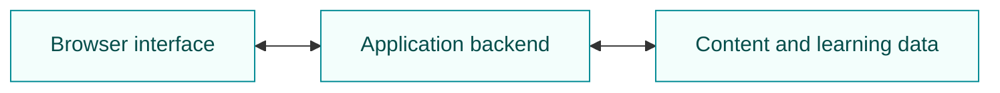

# 

**Learn a language through conversations you can follow, hear and respond to.**

I'm [Vincent Unruh](https://github.com/vincentunruh), building LingualGain across the browser interface, backend and content tooling. The app is in development; this is a showcase of implemented work, not a public demo.

## Inside The Product

The conversation stays at the centre. A learner can listen to a line, reveal its meaning, explore an unfamiliar expression and respond in context.

- **Follow the dialogue.** Move sentence by sentence through illustrated scenes, with audio playback.
- **Get help in place.** Reveal translations or open a word sheet without leaving the conversation.
- **Take a turn.** Answer choice-based and typed activities, then use the feedback to try again.
- **Practise aloud.** Record a response or practise pronunciation when the speech service is available.
- **Pick up later.** Resume a saved position and revisit previously encountered material through Review.

## Three Engineering Challenges

### 1. Navigation During Recording

A swipe can arrive while the microphone permission dialog or a response is still pending. The interface needs to cancel the old interaction, release resources and keep late results out of the next screen. I use explicit lifecycle ownership and scoped rendering rather than letting controls independently update the page.

**Checked:** cancelled recording requests, delayed responses, rapid clicks and feed navigation. [Read the case study](docs/engineering.md#1-navigation-and-asynchronous-interactions).

### 2. Meaning In Context

A word can mean something different inside an expression. Help needs to preserve that context instead of displaying an unrelated dictionary meaning or example. Context selection is separated from sheet rendering so the selection rules can be tested without the interface.

**Checked:** expression consistency, unrelated examples, duplicate alternatives and missing data. [Read the case study](docs/engineering.md#2-contextual-help-without-context-loss).

### 3. Content That Stays Consistent

Editing a dialogue can invalidate its translations, examples and exercises. I keep content versions, dependent material and review state distinct from delivery, so successful generation alone does not make material ready for learners.

**Checked:** changed structured content, mismatched languages and stale review evidence. [Read the case study](docs/engineering.md#3-dependent-content-and-readiness).

## Built With

| Layer | Tools and role |
| --- | --- |
| Interface | JavaScript, HTML and CSS for dialogue, help and practice |
| Backend | Node.js and Express for application behaviour and the HTTP API |
| Persistence | MongoDB for content and learning state |
| Development | esbuild for frontend bundles; Vitest and Playwright for regression testing |

## Evidence And Scope

A focused check on 31 October 2026 passed **67 tests across three suites, plus 23 pager checks**. These cover selected interactions and content contracts, not the entire application. [See the checks, results and limitations](docs/engineering.md#verification-snapshot).

Speech-provider quality, content qualification and learning effectiveness need separate validation. Product screenshots are omitted until their privacy and asset rights can be confirmed.

The application source remains private. This repository shares selected product and engineering work, not a runnable or open-source build.

[More about me](https://github.com/vincentunruh)
